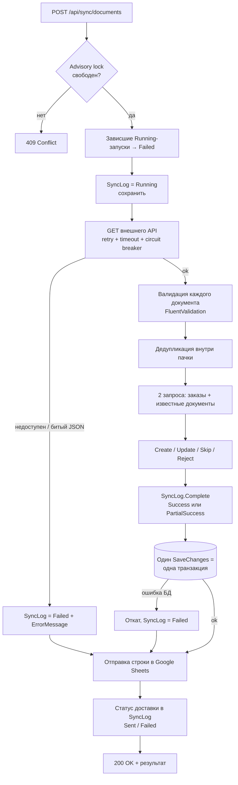

# LedgerSync

Сервис синхронизации финансовых документов (счета, акты выполненных работ) из внешней системы во внутреннюю
базу Order Management. Защищает от дублей, обновляет статусы, ведёт историю синхронизаций и отправляет журнал
каждого запуска в Google Sheets.

> Главный фокус решения — **надёжность**. Каждый риск, способ защиты от него, место в коде и тест, который это
> проверяет, собраны в [docs/reliability.md](docs/reliability.md).

## Содержание

1. [Как запустить проект](#1-как-запустить-проект)
2. [Как запустить тесты](#2-как-запустить-тесты)
3. [База данных](#3-база-данных)
4. [Как устроена синхронизация](#4-как-устроена-синхронизация)
5. [Как решена проблема дублей](#5-как-решена-проблема-дублей)
6. [Google Sheets interface](#6-google-sheets-interface)
7. [Документы по несуществующим заказам](#7-документы-по-несуществующим-заказам)
8. [Ограничения текущего решения](#8-ограничения-текущего-решения)
9. [Что улучшить перед production](#9-что-улучшить-перед-production)
10. [Использование AI-инструментов](#10-использование-ai-инструментов)

Дополнительно: [архитектура](#архитектура), [API](#api), [mock внешней системы](#mock-внешней-системы),
[конфигурация](#конфигурация), [принятые решения](#принятые-решения).

---

## Стек

| | |
|---|---|
| Платформа | .NET 10, ASP.NET Core Web API (controllers) |
| БД | PostgreSQL 17, Entity Framework Core 10 (Npgsql), миграции EF Core |
| Валидация | FluentValidation |
| Устойчивость HTTP | Microsoft.Extensions.Http.Resilience (Polly): retry, timeouts, circuit breaker |
| Документация API | OpenAPI + Scalar UI |
| Тесты | xUnit, EF Core InMemory, Testcontainers (PostgreSQL), WebApplicationFactory |
| Инфраструктура | Docker, Docker Compose |

**Почему .NET 10, а не рекомендованные .NET 8/9.** .NET 10 — текущий LTS-релиз (поддержка до ноября 2028),
он обратно совместим с API .NET 8/9, и всё используемое в решении (ASP.NET Core, EF Core, Npgsql) доступно
в нём в стабильных версиях. .NET 9 — STS-релиз с более коротким сроком поддержки. Код не использует
специфичных для .NET 10 возможностей, поэтому при необходимости переводится на .NET 8 сменой `TargetFramework`
и версий пакетов.

## 1. Как запустить проект

### Вариант A — Docker Compose (рекомендуется)

Нужен только Docker.

```bash
docker compose up -d --build
```

| Что | Адрес |
|---|---|
| API | http://localhost:8080 |
| Scalar UI (документация API) | http://localhost:8080/scalar |
| Health (liveness / readiness) | http://localhost:8080/health/live, http://localhost:8080/health/ready |
| PostgreSQL | `localhost:5433`, БД `ledgersync`, `postgres` / `postgres` |

Миграции применяются автоматически при старте, демо-заказы `ORD-001…ORD-003` добавляются, mock внешней системы
включён. Всё это включено явно в `docker-compose.yml`. Порты и пароль можно поменять: скопируйте `.env.example` в `.env`.

Быстрая проверка:

```bash
curl -X POST http://localhost:8080/api/sync/documents
```

```bash
curl http://localhost:8080/api/orders/ORD-001/documents
```

Остановить (с удалением данных — добавить `-v`):

```bash
docker compose down
```

### Вариант B — локально через .NET SDK

Нужны .NET 10 SDK и PostgreSQL. Проще всего поднять только базу из compose:

```bash
docker compose up -d postgres
```

```bash
dotnet run --project src/LedgerSync.Api --launch-profile http
```

API будет на http://localhost:5080, Scalar UI — http://localhost:5080/scalar. Окружение `Development`
включает миграции при старте, демо-заказы и mock внешней системы. Строка подключения —
в `src/LedgerSync.Api/appsettings.Development.json`.

> В окружении `Production` демо-функции выключены, а адрес внешней системы (`ExternalApi:BaseUrl`) и режим Google
> (`GoogleSheets:Mode`) обязательны. Без них приложение не стартует и сообщает, чего не хватает (проверено тестом).

Готовые запросы ко всем endpoint'ам — [src/LedgerSync.Api/LedgerSync.Api.http](src/LedgerSync.Api/LedgerSync.Api.http)
(Visual Studio, Rider, VS Code REST Client).

## 2. Как запустить тесты

```bash
dotnet test
```

| Проект | Что проверяет | Требования |
|---|---|---|
| `tests/LedgerSync.UnitTests` | Обработчики команд и запросов на реальном unit of work поверх EF Core InMemory, валидация, доменные инварианты, HTTP-клиент внешнего API и оба Google-логгера на подменённом транспорте | ничего |
| `tests/LedgerSync.IntegrationTests` | Весь путь по HTTP: API → обработчик → **настоящий PostgreSQL** (Testcontainers); unique index, advisory lock, отказ Google, отсутствие demo-функций в production | запущенный Docker |

Только unit-тесты (без Docker):

```bash
dotnet test tests/LedgerSync.UnitTests
```

Все 7 обязательных сценариев из задания покрыты в `SyncDocumentsCommandHandlerTests` (тесты помечены номерами 1–7)
и повторно — end-to-end в интеграционных тестах:

| № | Сценарий | Тест |
|---|---|---|
| 1 | Повторный запуск не создаёт дубли | `Handle_SameDataTwice_DoesNotCreateDuplicates`, `Sync_RunTwice_StoresEachDocumentOnce` |
| 2 | Новый документ создаётся | `Handle_NewDocument_IsCreatedWithAllFields` |
| 3 | Изменение статуса обновляет документ | `Handle_StatusChanged_UpdatesDocument`, `Sync_ChangedSource_UpdatesAndCreates` |
| 4 | Несуществующий заказ — по выбранной логике | `Handle_UnknownOrder_RejectsDocumentAndKeepsOthers`, `Sync_MixedBatch_...` |
| 5 | Ошибка источника сохраняется в SyncLog | `Handle_ExternalSourceFails_RecordsFailedRun`, `Sync_SourceBroken_...` |
| 6 | Успешный результат уходит в `IGoogleSheetLogger` | `Handle_Success_SendsRunToGoogleSheets` |
| 7 | Ошибка Google не откатывает документы | `Handle_GoogleSheetsUnavailable_...`, `GoogleSheetsDown_DocumentsStaySavedAndRunCanBeResent` |

## 3. База данных

**PostgreSQL 17**, доступ через **EF Core 10** (Npgsql), имена в `snake_case`.

| Таблица | Назначение | Важное |
|---|---|---|
| `orders` | Внутренние заказы | unique `order_number` |
| `external_documents` | Документы из внешней системы | **unique `external_id`**, FK на `orders`, `CHECK amount >= 0`, индекс по `order_number`, `numeric(18,2)` для сумм |
| `sync_logs` | История запусков | статус запуска и статус доставки в Google, индекс по `started_at DESC` |
| `sync_log_errors` | Отклонённые документы конкретного запуска | `external_id` + причина |

Статусы и типы хранятся строками (`Invoice`, `Signed`, `PartialSuccess`…), чтобы данные читались без справочников.
Одновременную запись исключает advisory lock (см. п. 4), поэтому оптимистичные блокировки не нужны.

**Демо-данные не входят в миграции.** Заказы `ORD-001`, `ORD-002`, `ORD-003` добавляет `DemoDataSeeder`
только при `Persistence:SeedDemoData=true` (Development, Docker, тесты). Seeder идемпотентен: добавляет только
отсутствующие заказы. `ORD-404` специально отсутствует — на нём показан сценарий «несуществующий заказ».

Миграции лежат в `src/LedgerSync.Infrastructure/Persistence/Migrations` и применяются при старте
(если `Persistence:ApplyMigrationsOnStartup=true`) или вручную:

```bash
dotnet tool restore
```

```bash
dotnet ef database update -p src/LedgerSync.Infrastructure -s src/LedgerSync.Api
```

SQL-скрипт для DBA:

```bash
dotnet ef migrations script -p src/LedgerSync.Infrastructure -s src/LedgerSync.Api -o schema.sql
```

## 4. Как устроена синхронизация

`POST /api/sync/documents` → `SyncDocumentsCommandHandler.HandleAsync`
([SyncDocumentsCommandHandler.cs](src/LedgerSync.Application/Features/Sync/SyncDocuments/SyncDocumentsCommandHandler.cs)):



Правила обработки каждого документа:

| Ситуация | Действие | Счётчик |
|---|---|---|
| Новый `externalId` | создать | `DocumentsCreated` |
| Известный, изменились `Status`, `Amount` или `ExternalUpdatedAt` | обновить (сумма обновляется вместе с валютой) | `DocumentsUpdated` |
| Известный, но пришёл с **другим заказом или типом** | отклонить, данные не меняются | `DocumentsSkipped`, статус `PartialSuccess` |
| Известный, данные не изменились | пропустить | `DocumentsSkipped` |
| Пришла **более старая** версия (`ExternalUpdatedAt` меньше сохранённого) | пропустить, warning в лог | `DocumentsSkipped` |
| Тот же `externalId` несколько раз в одном ответе | берётся самая свежая версия, остальные копии пропускаются | `DocumentsSkipped` |
| Невалидный документ (нет полей, неизвестный статус/тип, отрицательная сумма, дата в будущем, нечитаемое значение) | отклонить, причина в `sync_log_errors` | `DocumentsSkipped`, статус `PartialSuccess` |
| Несуществующий заказ | отклонить (см. п. 7) | `DocumentsSkipped`, статус `PartialSuccess` |

Инвариант: `Created + Updated + Skipped == Received`. Это проверяет сам домен (`SyncLog.Complete`).

Итоговые статусы запуска:

| Статус | Когда |
|---|---|
| `Success` | все документы обработаны без отклонений |
| `PartialSuccess` | часть документов отклонена (невалидные данные или неизвестный заказ), остальные сохранены |
| `Failed` | источник недоступен, ответ не является JSON-массивом, ошибка сохранения в БД или запуск прерван падением процесса |

**Атомарность.** Все изменения документов вместе со счётчиками и ошибками запуска сохраняются одним
`SaveChanges`, то есть одной транзакцией PostgreSQL. При любой ошибке на этом шаге в базу не попадает ничего,
а запуск отдельно фиксируется как `Failed` с текстом ошибки. Частично применённой синхронизации не бывает.

**Конкурентность.** Одновременно может идти только один запуск — на всех экземплярах приложения. Это
обеспечивает session-level advisory lock PostgreSQL. Если процесс упадёт, PostgreSQL сам снимет блокировку
вместе с соединением. Параллельный запрос получает `409 Conflict`.

## 5. Как решена проблема дублей

Защита в три слоя:

1. **Уровень БД** — уникальный индекс `ix_external_documents_external_id`. Даже при ошибке в коде PostgreSQL
   не даст сохранить второй документ с тем же `ExternalId`. Нарушение превращается в `PersistenceConflictException`
   и откатывает весь запуск (проверено интеграционным тестом).
2. **Уровень приложения** — перед записью одним запросом загружаются все уже известные документы пачки
   (`WHERE external_id = ANY(...)`). Известный документ обновляется или пропускается, но никогда не вставляется повторно.
3. **Внутри одного ответа** — если внешняя система прислала один `externalId` несколько раз, остаётся только
   последняя версия.

Плюс advisory lock исключает гонку двух параллельных синхронизаций за одни и те же документы.

## 6. Google Sheets interface

Контракт ([IGoogleSheetLogger.cs](src/LedgerSync.Application/Abstractions/GoogleSheets/IGoogleSheetLogger.cs)) — как в задании:

```csharp
public interface IGoogleSheetLogger
{
    Task SendSyncLogAsync(SyncLogDto syncLog, CancellationToken cancellationToken);
}
```

На каждый запуск в таблицу пишется одна строка: `RunId, StartedAt, FinishedAt, Status, DocumentsReceived,
DocumentsCreated, DocumentsUpdated, DocumentsSkipped, ErrorMessage`.

Реализации выбираются настройкой `GoogleSheets:Mode`:

| Mode | Реализация | Назначение |
|---|---|---|
| `File` | `FileGoogleSheetLogger` | **Вариант C (mock).** CSV-файл с теми же колонками, что и лист Google |
| `AppsScript` | `AppsScriptGoogleSheetLogger` | **Вариант B (реальная интеграция).** HTTP POST в Apps Script Web App ([google-apps-script/Code.gs](google-apps-script/Code.gs)) |

Свойства, важные для надёжности:

- **Отправка идёт только после коммита документов** и не может их откатить. Любая ошибка логгера перехватывается,
  в `sync_logs` сохраняется `google_sheet_status = Failed` и текст ошибки.
- **Идемпотентность.** И CSV-mock, и `Code.gs` делают upsert по `RunId`. Повторы HTTP (retry) и ручная повторная
  отправка не создают дубли строк.
- **Повторная отправка любого запуска**: последнего (`POST /api/sync/logs/latest/send-to-google`, как в задании)
  или конкретного (`POST /api/sync/logs/{runId}/send-to-google`). Так можно доставить и запуск, который упал
  в Google раньше последнего.
- Режим обязателен: production не может незаметно работать на mock.
- Для Apps Script настроены retry с backoff, таймауты и circuit breaker. Тело ответа проверяется явно
  (Apps Script возвращает 200 даже при ошибке скрипта).
- CSV пишется во временный файл и атомарно подменяется — сбой не оставит половину файла.

### Как проверить

- Локально: файл `src/LedgerSync.Api/google-sheets-mock/sync-log.csv`.
- В Docker:

  ```bash
  docker compose exec api cat google-sheets-mock/sync-log.csv
  ```

- Сценарий отказа: указать недоступный адрес Apps Script, например
  `GOOGLE_SHEETS_MODE=AppsScript GOOGLE_SHEETS_APPS_SCRIPT_URL=http://localhost:9/ docker compose up -d`.
  Синхронизация проходит, документы сохранены, после повторов в ответе `"googleSheetStatus": "Failed"`.
  После возврата `File` повторная отправка `POST /api/sync/logs/latest/send-to-google` даёт `Sent`.
  В автотестах отказ имитирует тестовый `UnavailableGoogleSheetLogger`, в боевом коде такого режима нет.

### Как переключиться на реальную Google-таблицу

1. Создать Google-таблицу → Extensions → Apps Script → вставить [google-apps-script/Code.gs](google-apps-script/Code.gs).
2. Deploy → New deployment → Web app, *Execute as: Me*, *Who has access: Anyone with the link*.
3. Передать URL **не через git**, а через переменные окружения или user-secrets:

   ```bash
   dotnet user-secrets set "GoogleSheets:AppsScriptUrl" "<deployment-url>" --project src/LedgerSync.Api
   ```

   В Docker — переменные `GOOGLE_SHEETS_MODE=AppsScript` и `GOOGLE_SHEETS_APPS_SCRIPT_URL` в `.env` (файл в `.gitignore`).
4. Указать `GoogleSheets:Mode=AppsScript`. При неверной конфигурации приложение не стартует (`ValidateOnStart`).

Вариант A (Sheets API + Service Account) добавляется новой реализацией `IGoogleSheetLogger` в
`Infrastructure/GoogleSheets` и одной веткой в `DependencyInjection.AddGoogleSheets`. Остальной код не меняется.

## 7. Документы по несуществующим заказам

**Выбранное поведение: документ отклоняется и записывается в журнал ошибок запуска.**

- Документ **не сохраняется** в `external_documents`, заказ автоматически **не создаётся**.
- В `sync_log_errors` пишется `external_id` и причина `Order 'ORD-404' does not exist.`, в лог — warning (EventId 1101).
- Документ учитывается в `DocumentsSkipped`, запуск получает статус `PartialSuccess`. Остальные документы пачки сохраняются.
- Ошибки видны в `GET /api/sync/logs` (поле `errors`).

Почему так: создавать заказ из финансового документа опасно — у документа нет данных клиента, и появились бы
«пустые» заказы. Orphan-документы без связи с заказом нарушили бы FK и усложнили бы все запросы. Отклонение
с подробным журналом сохраняет целостность данных и не теряет информацию. Когда заказ появится, документ
будет создан при следующей синхронизации, ведь внешняя система отдаёт полный список.

## 8. Ограничения текущего решения

- **Полная синхронизация каждый раз.** Внешний API отдаёт весь список, без инкрементальной выгрузки
  (`updatedSince`) и пагинации. Ответ ограничен 10 МБ (`ExternalApi:MaxResponseSizeMb`).
- **Одна транзакция на запуск.** Это даёт атомарность, но на очень больших пачках транзакция будет долгой.
- **Запуск только вручную** через API, без планировщика.
- **Google отправляется синхронно после коммита.** Если процесс упадёт между коммитом и отправкой, строка останется
  в статусе `Pending`, и её нужно переотправить вручную (`POST /api/sync/logs/{runId}/send-to-google`).
  Автоматического повтора (outbox) нет.
- **Зависший запуск** (процесс упал во время синхронизации) помечается `Failed` только при следующем запуске.
- **Переходы статусов не проверяются.** Источник истины — внешняя система, поэтому, например, `Signed → Created`
  с более новой датой будет принят. Защита есть только от устаревших версий (более старая `ExternalUpdatedAt`).
- **`DocumentsSkipped` включает и отклонённые документы** (так предписывает модель `SyncLog` из задания).
  Отклонённые видны отдельно в `errors` и по статусу `PartialSuccess`.
- Номер документа (`DocumentNumber`) после создания не обновляется: по заданию отслеживаются `Status`, `Amount`
  (вместе с валютой) и `ExternalUpdatedAt`.
- Нет аутентификации и авторизации (по заданию не требуются).
- Mock внешней системы работает в том же процессе (вариант 1 из задания) и включается только флагом.
- Реальная интеграция с Google (Apps Script) покрыта тестами на подменённом HTTP, но против настоящей таблицы
  в рамках задания не проверялась.

## 9. Что улучшить перед production

1. **Transactional outbox** для Google Sheets: событие пишется в той же транзакции, фоновый воркер доставляет
   с retry. Так ни одна строка не потеряется даже при падении процесса.
2. **Планировщик и инкрементальная синхронизация**: фоновый запуск по расписанию, курсор `updatedSince`,
   пагинация, обработка пачками.
3. **Наблюдаемость**: OpenTelemetry (traces + metrics: длительность, счётчики, доля `Failed`), алерты на
   `Failed` / `PartialSuccess` и на рост `google_sheet_status = Failed`.
4. **Безопасность**: аутентификация (JWT / API key), rate limiting, секреты в Vault / Key Vault, Service Account
   для Sheets API вместо публичного Web App URL.
5. **Миграции через migration bundle в CI/CD**, а не при старте приложения.
6. **CI**: сборка, тесты (включая Testcontainers), анализаторы, проверка уязвимых пакетов.
7. Retention-политика для `sync_logs` и `sync_log_errors`, индекс по статусу для мониторинга.
8. Отдельный сервис или контракт для внешней системы (сейчас mock в процессе).

## 10. Использование AI-инструментов

Использовался **Claude Code** (Anthropic):

- разбор тестового задания и составление плана по версиям;
- генерация каркаса решения, кода слоёв, EF-конфигураций, тестов и черновика документации по моим требованиям
  (Clean Architecture, Enumeration-классы вместо enum, отдельные extensions для builder и app, акцент на надёжность);
- проверка сценариев: запуск API на реальном PostgreSQL, прогон тестов и docker-compose.

Архитектурные решения, код и тесты я проверил и могу объяснить: почему одна транзакция на запуск,
зачем advisory lock, как работает upsert по `RunId` и т. д.

---

## Архитектура

Clean Architecture, зависимости направлены внутрь:

```
Api ──► Infrastructure ──► Application ──► Domain
 └───────────────────────► Application
```

| Проект | Ответственность |
|---|---|
| `LedgerSync.Domain` | Сущности (`Order`, `ExternalDocument`, `SyncLog`, `SyncLogError`), Enumeration-классы, инварианты. Без внешних зависимостей |
| `LedgerSync.Application` | Команды и запросы с обработчиками (`Features/*`), порты (интерфейсы), DTO, валидаторы, мапперы, структурированные log-события |
| `LedgerSync.Infrastructure` | EF Core + PostgreSQL, unit of work с репозиториями, advisory lock, HTTP-клиент внешнего API, Google-логгеры |
| `LedgerSync.Api` | Контроллеры, глобальный exception handler, health checks, OpenAPI, composition root; mock внешней системы в отдельной папке `MockExternalApi`, подключается только флагом |

### CQRS

Команды меняют состояние, запросы только читают. У каждой операции свой обработчик:

| Тип | Операция | Endpoint |
|---|---|---|
| Command | `SyncDocumentsCommand` | `POST /api/sync/documents` |
| Command | `ResendSyncLogCommand` | `POST /api/sync/logs/latest/send-to-google`, `POST /api/sync/logs/{runId}/send-to-google` |
| Query | `GetSyncLogsQuery` | `GET /api/sync/logs` |
| Query | `GetOrderDocumentsQuery` | `GET /api/orders/{orderNumber}/documents` |

Реализация намеренно лёгкая, без enterprise-обвязки:

- **Без MediatR и диспетчера.** Интерфейсы `ICommand`/`IQuery` и `ICommandHandler`/`IQueryHandler`
  ([Abstractions/Messaging](src/LedgerSync.Application/Abstractions/Messaging)) занимают несколько строк. Контроллер
  получает нужный обработчик через `[FromServices]`, поэтому путь вызова виден без «магии». MediatR с v13
  распространяется по коммерческой лицензии, а для четырёх операций посредник ничего не даёт.
- **Без pipeline behaviors.** Валидация — один явный вызов `ValidateAndThrowAsync` в начале обработчика.
- **Одна модель данных** для чтения и записи, без отдельных read-моделей и баз.
- **Папка на операцию, один тип на файл**: запрос, валидатор и обработчик лежат рядом
  (`Features/SyncLogs/GetSyncLogs/`), поэтому всё про одну операцию находится в одном месте.

Что ещё упрощено сознательно:

- нет навигационных свойств между `Order` и `ExternalDocument`: связи хватает внешнего ключа `OrderId`;
- нет оптимистичных блокировок (`xmin`): единственного писателя уже гарантирует advisory lock;
- нет demo-режимов в боевом коде: отказ Google имитируется только в тестах, mock-API и демо-заказы
  включаются только флагами конфигурации.

### Unit of Work

`IUnitOfWork` — единственная зависимость обработчиков от слоя хранения. Он отдаёт репозитории
(`Orders`, `Documents`, `SyncLogs`) поверх одного `DbContext`, и `SaveChangesAsync` фиксирует изменения всех
репозиториев одной транзакцией. Репозитории отдельно в DI не регистрируются.

### Настройка хоста

Настройка хоста вынесена в extensions: [WebApplicationBuilderExtensions](src/LedgerSync.Api/Extensions/WebApplicationBuilderExtensions.cs)
(`AddLedgerSyncServices`) и [WebApplicationExtensions](src/LedgerSync.Api/Extensions/WebApplicationExtensions.cs)
(`InitializeDatabaseAsync`, `UseLedgerSyncPipeline`), поэтому `Program.cs` занимает несколько строк.

## API

| Метод | Путь | Ответы |
|---|---|---|
| `POST` | `/api/sync/documents` | `200` результат запуска (в т. ч. `Failed` — это записанный исход), `409` если уже идёт другой запуск |
| `GET` | `/api/orders/{orderNumber}/documents` | `200`, `400` невалидный номер, `404` заказ не найден |
| `GET` | `/api/sync/logs?take=20` | `200` последние запуски с ошибками по документам, `400` если `take` вне 1..100 |
| `POST` | `/api/sync/logs/latest/send-to-google` | `200` статус доставки, `404` запусков ещё не было, `409` последний запуск ещё идёт |
| `POST` | `/api/sync/logs/{runId}/send-to-google` | `200` статус доставки, `404` запуск не найден, `409` запуск ещё идёт |
| `GET` | `/health/live`, `/health/ready` | liveness / readiness (проверка БД) |

Даты в ответах — UTC в формате из задания: `"2026-06-20T10:00:00Z"`.

Пример ответа синхронизации:

```json
{
  "runId": "6ae2e5f4-c3f7-455e-b8c8-fd97b5cef4f7",
  "status": "PartialSuccess",
  "documentsReceived": 6,
  "documentsCreated": 0,
  "documentsUpdated": 0,
  "documentsSkipped": 6,
  "errorMessage": null,
  "googleSheetStatus": "Sent"
}
```

Все ошибки возвращаются в формате RFC 7807 (`application/problem+json`) с `traceId` для поиска в логах:

```json
{
  "title": "Not found",
  "status": 404,
  "detail": "Order 'ORD-404' was not found.",
  "instance": "/api/orders/ORD-404/documents",
  "traceId": "00-e8c7b3f687bd98486aef41df4c88f90b-f7f9dae941b61efa-00"
}
```

## Mock внешней системы

Реализован вариант 1 из задания: endpoint внутри того же приложения. Код изолирован в папке
`src/LedgerSync.Api/MockExternalApi` и подключается только при `MockExternalApi:Enabled=true` (Development, Docker,
тесты). В production его маршрутов нет совсем, это проверено тестом. Сервис синхронизации ходит к mock
**по настоящему HTTP** через тот же клиент с retry и таймаутами, что и к реальной системе, поэтому замена на
реальную систему — это только смена `ExternalApi:BaseUrl`. Сценарий переключается без перезапуска:

```bash
curl -X PUT http://localhost:8080/mock/external/scenario/Updated
```

| Сценарий | Что возвращает | Ожидаемый результат синхронизации |
|---|---|---|
| `Baseline` | 4 валидных документа | 1-й запуск: created 4; повторный: skipped 4 |
| `Updated` | 2 документа сменили статус/сумму, 1 новый | created 1, updated 2, skipped 2 |
| `Mixed` | заказ `ORD-404`, невалидные поля, нечитаемая сумма, дубль внутри ответа | `PartialSuccess`, ошибки в `errors` |
| `Stale` | старая версия известного документа | skipped 1, данные не откатываются |
| `Malformed` | битый JSON | `Failed`: `External source returned malformed JSON.` |
| `Unavailable` | HTTP 503 | retry → `Failed`: `External source returned HTTP 503 ...` |

Данные сценариев: `src/LedgerSync.Api/MockExternalApi/Data/*.json`.

## Конфигурация

| Ключ | По умолчанию | Описание |
|---|---|---|
| `ConnectionStrings:LedgerSync` | — | Строка подключения PostgreSQL (обязательна) |
| `Persistence:ApplyMigrationsOnStartup` | `false` (`true` в Development/Docker) | Применять миграции при старте, с повторами пока БД поднимается |
| `Persistence:SeedDemoData` | `false` (`true` в Development/Docker) | Добавить демо-заказы `ORD-001…003` |
| `ExternalApi:BaseUrl` | — (обязателен; в Development `http://localhost:5080`) | Адрес внешней системы |
| `ExternalApi:AttemptTimeoutSeconds` / `MaxRetryAttempts` | `10` / `3` | Таймаут попытки и число повторов |
| `GoogleSheets:Mode` | — (обязателен; в Development/Docker `File`) | `File` (mock CSV) или `AppsScript` |
| `GoogleSheets:AppsScriptUrl` | — | URL Web App (секрет, не коммитить) |
| `MockExternalApi:Enabled` | `false` (`true` в Development/Docker) | Подключить mock внешней системы |
| `MockExternalApi:Scenario` | `Baseline` | Начальный сценарий mock |
| `OpenApi:Enabled` | `false` (всегда включено в Development) | Публиковать OpenAPI и Scalar UI |

Все секции валидируются при старте (`ValidateOnStart`): при неверной конфигурации приложение не запустится.

## Принятые решения

| Вопрос | Решение | Почему |
|---|---|---|
| Enum или класс | `Enumeration<T>` (smart enum) | Нельзя получить неопределённое значение, есть безопасный `TryFromName` для недоверенных данных, имена совпадают в БД, API и коде |
| Исключения | Узкие типы: `InvalidEntityDataException`, `UnknownEnumerationValueException`, `SyncRunAlreadyFinishedException`, `SyncAlreadyRunningException`, `OrderNotFoundException`… | По названию сразу понятно, что произошло. Exception handler точно маппит их в HTTP-коды |
| Маппинг | Явные extension-методы вместо AutoMapper | 4 DTO, маппинг проверяется компилятором и читается без «магии». AutoMapper с v15 распространяется по коммерческой лицензии |
| Валидация | FluentValidation для внешних данных и параметров запросов | Внешние данные недоверенные: проверяются до попадания в домен, все ошибки собираются сразу и сохраняются в журнал |
| EF-конфигурация | Fluent API (`IEntityTypeConfiguration`) | Домен остаётся чистым от атрибутов, ограничения БД описаны в одном месте |
| Кэширование | Не используется | Данные меняются при каждой синхронизации, чтение — один индексированный запрос. Кэш дал бы риск устаревших данных без ощутимой выгоды. При росте нагрузки — `HybridCache` с инвалидацией после синхронизации |
| Время | `TimeProvider` | Детерминированные тесты, все даты нормализуются в UTC |
| Логирование | `LoggerMessage` source generator, стабильные EventId, scope `RunId` | Все записи одного запуска связаны по `RunId`; в Docker логи в JSON |
