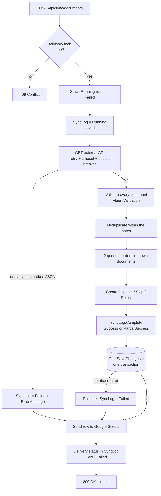

# LedgerSync

A service that synchronizes financial documents (invoices and acts of work) from an external system into the
internal Order Management database. It protects against duplicates, keeps statuses up to date, records the history
of every sync run and sends a journal row for each run to Google Sheets.

> The main focus of the solution is **reliability and data accuracy**. The key decisions are summarized in
> [Reliability, data accuracy and security](#reliability-data-accuracy-and-security-key-decisions).
> The full "risk → protection → code → test" map is in [docs/reliability.md](docs/reliability.md).

## Contents

1. [How to run the project](#1-how-to-run-the-project)
2. [How to run the tests](#2-how-to-run-the-tests)
3. [Database](#3-database)
4. [How synchronization works](#4-how-synchronization-works)
5. [How duplicates are prevented](#5-how-duplicates-are-prevented)
6. [Google Sheets interface](#6-google-sheets-interface)
7. [Documents for non-existent orders](#7-documents-for-non-existent-orders)
8. [Limitations of the current solution](#8-limitations-of-the-current-solution)
9. [What to improve before production](#9-what-to-improve-before-production)
10. [Use of AI tools](#10-use-of-ai-tools)

Also: [reliability, data accuracy and security](#reliability-data-accuracy-and-security-key-decisions),
[architecture](#architecture), [API](#api), [external system mock](#external-system-mock),
[configuration](#configuration), [design decisions](#design-decisions).

---

## Stack

| | |
|---|---|
| Platform | .NET 10, ASP.NET Core Web API (controllers) |
| Database | PostgreSQL 17, Entity Framework Core 10 (Npgsql), EF Core migrations |
| Validation | FluentValidation |
| HTTP resilience | Microsoft.Extensions.Http.Resilience (Polly): retry, timeouts, circuit breaker |
| API documentation | OpenAPI + Scalar UI |
| Tests | xUnit, EF Core InMemory, Testcontainers (PostgreSQL), WebApplicationFactory |
| Infrastructure | Docker, Docker Compose |

**Why .NET 10 instead of the recommended .NET 8/9.** .NET 10 is the current LTS release (supported until
November 2028). It is backward compatible with the .NET 8/9 APIs, and everything the solution uses (ASP.NET Core,
EF Core, Npgsql) is available for it in stable versions. .NET 9 is an STS release with a shorter support window.
The code does not rely on .NET 10-specific features, so it can be moved to .NET 8 by changing `TargetFramework`
and package versions.

## 1. How to run the project

### Option A — Docker Compose (recommended)

Only Docker is required.

```bash
docker compose up -d --build
```

| What | Address |
|---|---|
| API | http://localhost:8080 |
| Scalar UI (API documentation) | http://localhost:8080/scalar |
| PostgreSQL | `localhost:5433`, database `ledgersync`, `postgres` / `postgres` |

Migrations are applied automatically on startup, the demo orders `ORD-001…ORD-003` are added and the external
system mock is enabled. All of this is switched on explicitly in `docker-compose.yml`. Ports and the password can be
changed: copy `.env.example` to `.env`.

Quick check:

```bash
curl -X POST http://localhost:8080/api/sync/documents
```

```bash
curl http://localhost:8080/api/orders/ORD-001/documents
```

Stop (add `-v` to delete the data as well):

```bash
docker compose down
```

### Option B — locally with the .NET SDK

Requires the .NET 10 SDK and PostgreSQL. The easiest way is to start only the database from compose:

```bash
docker compose up -d postgres
```

```bash
dotnet run --project src/LedgerSync.Api --launch-profile http
```

The API runs at http://localhost:5080, Scalar UI at http://localhost:5080/scalar. The `Development` environment
enables migrations on startup, the demo orders and the external system mock. The connection string is in
`src/LedgerSync.Api/appsettings.Development.json`.

> In the `Production` environment the demo features are off and the external system address
> (`ExternalApi:BaseUrl`) is required. Without it the application refuses to start and says what is missing
> (covered by a test).

Ready-made requests for every endpoint are in [src/LedgerSync.Api/LedgerSync.Api.http](src/LedgerSync.Api/LedgerSync.Api.http)
(Visual Studio, Rider, VS Code REST Client).

## 2. How to run the tests

```bash
dotnet test
```

| Project | What it checks | Requirements |
|---|---|---|
| `tests/LedgerSync.UnitTests` | Command and query handlers on the real unit of work over EF Core InMemory, validation, domain invariants, the external API HTTP client over a stubbed transport, the Google Sheets mock logger | none |
| `tests/LedgerSync.IntegrationTests` | The whole path over HTTP: API → handler → **real PostgreSQL** (Testcontainers); unique index, advisory lock, Google failure, no demo features in production | Docker running |

Unit tests only (no Docker):

```bash
dotnet test tests/LedgerSync.UnitTests
```

All 7 mandatory scenarios from the assignment are covered in `SyncDocumentsCommandHandlerTests` (the tests are
numbered 1–7) and again end to end in the integration tests:

| # | Scenario | Test |
|---|---|---|
| 1 | A repeated run creates no duplicates | `Handle_SameDataTwice_DoesNotCreateDuplicates`, `Sync_RunTwice_StoresEachDocumentOnce` |
| 2 | A new document is created | `Handle_NewDocument_IsCreatedWithAllFields` |
| 3 | A status change updates the document | `Handle_StatusChanged_UpdatesDocument`, `Sync_ChangedSource_UpdatesAndCreates` |
| 4 | A non-existent order is handled by the chosen rule | `Handle_UnknownOrder_RejectsDocumentAndKeepsOthers`, `Sync_MixedBatch_...` |
| 5 | A source error is saved in SyncLog | `Handle_ExternalSourceFails_RecordsFailedRun`, `Sync_SourceBroken_...` |
| 6 | A successful result is sent to `IGoogleSheetLogger` | `Handle_Success_SendsRunToGoogleSheets` |
| 7 | A Google error does not roll back documents | `Handle_GoogleSheetsUnavailable_...`, `GoogleSheetsDown_DocumentsStaySavedAndRunCanBeResent` |

## 3. Database

**PostgreSQL 17**, accessed through **EF Core 10** (Npgsql), `snake_case` names.

| Table | Purpose | Notes |
|---|---|---|
| `orders` | Internal orders | unique `order_number` |
| `external_documents` | Documents from the external system | **unique `external_id`**, FK to `orders`, `CHECK amount >= 0`, index on `order_number`, `numeric(18,2)` for amounts |
| `sync_logs` | Run history | run status and Google delivery status, index on `started_at DESC` |
| `sync_log_errors` | Rejected documents of a run | `external_id` + reason |

Statuses and types are stored as strings (`Invoice`, `Signed`, `PartialSuccess`…) so the data is readable without
lookup tables. Concurrent writes are excluded by the advisory lock (see section 4), so optimistic locking is not needed.

**Demo data is not part of the migrations.** The orders `ORD-001`, `ORD-002`, `ORD-003` are added by
`DatabaseInitializer` only when `Persistence:SeedDemoData=true` (Development, Docker, tests). Seeding is idempotent:
only missing orders are created. `ORD-404` is intentionally absent — it demonstrates the "non-existent order" scenario.

Migrations live in `src/LedgerSync.Infrastructure/Persistence/Migrations` and are applied on startup
(when `Persistence:ApplyMigrationsOnStartup=true`) or manually:

```bash
dotnet tool restore
```

```bash
dotnet ef database update -p src/LedgerSync.Infrastructure -s src/LedgerSync.Api
```

SQL script for a DBA:

```bash
dotnet ef migrations script -p src/LedgerSync.Infrastructure -s src/LedgerSync.Api -o schema.sql
```

## 4. How synchronization works

`POST /api/sync/documents` → `SyncDocumentsCommandHandler.HandleAsync`
([SyncDocumentsCommandHandler.cs](src/LedgerSync.Application/Features/Sync/SyncDocuments/SyncDocumentsCommandHandler.cs)):



Rules for each document:

| Situation | Action | Counter |
|---|---|---|
| New `externalId` | create | `DocumentsCreated` |
| Known, `Status`, `Amount` or `ExternalUpdatedAt` changed | update (the amount is updated together with the currency) | `DocumentsUpdated` |
| Known, but arrived with **a different order or type** | reject, stored data is not changed | `DocumentsSkipped`, status `PartialSuccess` |
| Known, data unchanged | skip | `DocumentsSkipped` |
| An **older** version arrived (`ExternalUpdatedAt` earlier than the stored one) | skip, warning in the log | `DocumentsSkipped` |
| The same `externalId` several times in one response | the latest version is used, the other copies are skipped | `DocumentsSkipped` |
| Invalid document (missing fields, unknown status/type, negative amount, date in the future, unreadable value) | reject, reason in `sync_log_errors` | `DocumentsSkipped`, status `PartialSuccess` |
| Non-existent order | reject (see section 7) | `DocumentsSkipped`, status `PartialSuccess` |

Invariant: `Created + Updated + Skipped == Received`. The domain itself checks it (`SyncLog.Complete`).

Final run statuses:

| Status | When |
|---|---|
| `Success` | all documents processed without rejections |
| `PartialSuccess` | some documents were rejected (invalid data or unknown order), the rest were saved |
| `Failed` | the source is unavailable, the response is not a JSON array, any other error while calling the source, a database save error, or the run was interrupted by a process crash |

While a run is in progress its record has the intermediate status `Running`. It makes the run visible in the
journal before the external system is called, and it is always replaced by one of the three final statuses
from the assignment.

**Atomicity.** All document changes together with the run counters and errors are saved by one `SaveChanges`,
that is, one PostgreSQL transaction. On any error at this step nothing reaches the database, and the run itself is
recorded separately as `Failed` with the error text. A partially applied sync never happens.

**Concurrency.** Only one run can be in progress at a time — across all application instances. This is ensured by a
session-level PostgreSQL advisory lock. If the process crashes, PostgreSQL releases the lock together with the
connection. A parallel request gets `409 Conflict`.

## 5. How duplicates are prevented

Three layers of protection:

1. **Database level** — the unique index `ix_external_documents_external_id`. Even if the code has a bug,
   PostgreSQL will not store a second document with the same `ExternalId`. The violation becomes a
   `PersistenceConflictException` and rolls back the whole run (covered by an integration test).
2. **Application level** — before writing, all already known documents of the batch are loaded in one query
   (`WHERE external_id = ANY(...)`). A known document is updated or skipped, but never inserted again.
3. **Within one response** — if the external system sends the same `externalId` several times, only the latest
   version is kept.

On top of that, the advisory lock rules out a race between two parallel syncs over the same documents.

## 6. Google Sheets interface

The contract ([IGoogleSheetLogger.cs](src/LedgerSync.Application/Abstractions/GoogleSheets/IGoogleSheetLogger.cs)) is the one from the assignment:

```csharp
public interface IGoogleSheetLogger
{
    Task SendSyncLogAsync(SyncLogDto syncLog, CancellationToken cancellationToken);
}
```

Each run writes one row to the sheet: `RunId, StartedAt, FinishedAt, Status, DocumentsReceived,
DocumentsCreated, DocumentsUpdated, DocumentsSkipped, ErrorMessage`.

**Option C from the assignment was chosen: a mock implementation**, `FileGoogleSheetLogger`. It writes rows to a CSV
file with the same columns as the Google sheet. The assignment allows a mock client as long as the code has a
dedicated interface that can be replaced with a real integration; this condition is met. All the logic around
sending (when to send, what to do on failure, how to resend) does not depend on the implementation and works the
same with the mock and with real Google.

Properties that matter for reliability:

- **Sending happens only after the documents are committed** and cannot roll them back. Any logger error is caught,
  and `google_sheet_status = Failed` with the error text is saved in `sync_logs`.
- **Any run can be resent**: the latest one (`POST /api/sync/logs/latest/send-to-google`, as in the assignment)
  or a specific one (`POST /api/sync/logs/{runId}/send-to-google`). This way a run that failed to reach Google
  before the latest one can still be delivered.
- **Idempotency.** The row is looked up by `RunId` and updated, so a resend does not create a duplicate.
- The CSV is written to a temporary file and swapped atomically — a crash never leaves a half-written file.

### How to check

- Locally: the file `src/LedgerSync.Api/google-sheets-mock/sync-log.csv`.
- In Docker:

  ```bash
  docker compose exec api cat google-sheets-mock/sync-log.csv
  ```

- Google failure and resending are covered by automated tests, where the logger is replaced with one that always
  fails (`Handle_GoogleSheetsUnavailable_...`, `GoogleSheetsDown_DocumentsStaySavedAndRunCanBeResent`).

### How to replace the mock with a real Google sheet

1. Add an `IGoogleSheetLogger` implementation in `Infrastructure/GoogleSheets`, for example `SheetsApiGoogleSheetLogger`
   on the `Google.Apis.Sheets.v4` package with a Service Account (option A) or an HTTP POST to an Apps Script Web App
   (option B). The row should be looked up by `RunId` and updated rather than appended, so retries stay idempotent.
2. Register it instead of `FileGoogleSheetLogger` in `InfrastructureServiceCollectionExtensions.AddGoogleSheets`.
3. Pass secrets (the Service Account key JSON or the Web App URL) through environment variables or a secret store,
   never through git.

The rest of the code — handlers, resending, the journal — stays the same.

## 7. Documents for non-existent orders

**Chosen behavior: the document is rejected and recorded in the run's error log.**

- The document is **not saved** to `external_documents`, and the order is **not created** automatically.
- `sync_log_errors` gets the `external_id` and the reason `Order 'ORD-404' does not exist.`; the log gets a warning (EventId 1101).
- The document counts towards `DocumentsSkipped`, and the run gets the status `PartialSuccess`. The other documents of the batch are saved.
- The errors are visible in `GET /api/sync/logs` (the `errors` field).

Why: creating an order from a financial document is risky — the document has no client data, so "empty" orders
would appear. Orphan documents without an order would break the FK and complicate every query. Rejecting with a
detailed log keeps the data consistent and loses no information. Once the order appears, the document is created on
the next sync, since the external system returns the full list.

## 8. Limitations of the current solution

- **Full sync every time.** The external API returns the whole list, without incremental export (`updatedSince`)
  and without pagination.
- **One transaction per run.** This gives atomicity, but on very large batches the transaction will be long.
- **Runs are started manually** through the API, there is no scheduler.
- **Google is called synchronously after the commit.** If the process crashes between the commit and sending,
  the row stays `Pending` and has to be resent manually (`POST /api/sync/logs/{runId}/send-to-google`).
  There is no automatic retry (outbox).
- **A stuck run** (the process crashed during a sync) is marked `Failed` only on the next run.
- **Status transitions are not checked.** The external system is the source of truth, so, for example,
  `Signed → Created` with a newer date is accepted. Only outdated versions (an older `ExternalUpdatedAt`) are rejected.
- **`DocumentsSkipped` includes rejected documents too** (as prescribed by the `SyncLog` model in the assignment).
  Rejected documents are visible separately in `errors` and through the `PartialSuccess` status.
- The document number (`DocumentNumber`) is not updated after creation: per the assignment, `Status`, `Amount`
  (together with the currency) and `ExternalUpdatedAt` are tracked.
- No authentication or authorization (not required by the assignment).
- The external system mock runs in the same process (option 1 from the assignment) and is enabled only by a flag.
- Google Sheets is represented by a mock implementation (option C, allowed by the assignment); a real sheet is
  plugged in with a separate `IGoogleSheetLogger` implementation (see section 6).

## 9. What to improve before production

1. **Transactional outbox** for Google Sheets: the event is written in the same transaction and a background worker
   delivers it with retries. No row is lost even if the process crashes.
2. **Scheduler and incremental sync**: scheduled background runs, an `updatedSince` cursor, pagination,
   processing in chunks.
3. **Observability**: OpenTelemetry (traces + metrics: duration, counters, share of `Failed`), alerts on
   `Failed` / `PartialSuccess` and on growing `google_sheet_status = Failed`.
4. **A real Google sheet** instead of the mock (Sheets API + Service Account), secrets in Vault / Key Vault.
5. **Security**: authentication (JWT / API key), rate limiting.
6. **Migrations through a migration bundle in CI/CD** instead of on application startup.
7. **CI**: build, tests (including Testcontainers), analyzers, vulnerable package checks.
8. A retention policy for `sync_logs` and `sync_log_errors`, an index on status for monitoring.
9. A separate service or contract for the external system (currently an in-process mock).

## 10. Use of AI tools

**Claude Code** (Anthropic) was used for:

- analyzing the assignment and planning the work in versions;
- generating the solution skeleton, the code of the layers, EF configurations, tests and a draft of the
  documentation according to my requirements (Clean Architecture, Enumeration classes instead of enums,
  separate extensions for the builder and the app, focus on reliability);
- checking the scenarios: running the API against real PostgreSQL, running the tests and docker-compose.

I have reviewed the architectural decisions, the code and the tests and can explain them: why one transaction per
run, why the advisory lock, how the upsert by `RunId` works, and so on.

---

## Reliability, data accuracy and security: key decisions

The main decisions in one place. For each item, [docs/reliability.md](docs/reliability.md) points to the code and
the test that checks it.

### Reliability: a failure neither loses nor corrupts data

| Decision | What it gives |
|---|---|
| **One transaction per run** | Documents, counters and run errors are saved by one `SaveChanges`. On an error nothing reaches the database; a partially applied sync never happens |
| **The run is recorded before any work** | The `Running` record is created before the external system is called, and any outcome finishes it as `Success`, `PartialSuccess` or `Failed` with a reason. No run is left without a trace in the journal |
| **One run at a time** | The PostgreSQL advisory lock covers all application instances; a parallel request gets `409`. There is no race over the same documents |
| **Recovery after a process crash** | PostgreSQL releases the lock when the connection drops, and the next run marks the stuck record as `Failed` |
| **The run is not tied to the HTTP request** | A client disconnect does not leave a sync half done |
| **Resilient calls to the external system** | Timeouts, retries with growing delays and a circuit breaker. Once the retries are exhausted the run finishes as `Failed` and documents are not touched |
| **A bad document does not break the batch** | Each document is parsed and validated on its own: a bad one is rejected with a reason, the rest are saved |
| **Google is isolated from the data** | Sending happens only after the documents are committed. A failure is recorded in the journal and does not roll back data; any run can be resent by `runId`, and a resend does not duplicate the row |
| **A configuration error shows up immediately** | Without the external system address or the connection string the application refuses to start and says what is missing |

### Data accuracy: only correct and current values reach the database

| Decision | What it gives |
|---|---|
| **Duplicates are excluded in three layers** | A unique index in the database, a lookup of known documents before writing, deduplication within one response |
| **Money without loss of precision** | `decimal` in code and `numeric(18,2)` in the database, no floating point. A negative amount or one with more than two decimal places is rejected: by the validator, by the entity invariant and by a `CHECK` in the database |
| **Amount and currency change only together** | A new amount can never end up with the old currency |
| **UTC time only** | All dates are converted to UTC on input, stored as `timestamptz` and returned as `2026-06-20T10:00:00Z`. The same moment in different time zones is not treated as a change |
| **An old version does not overwrite a new one** | A document with an earlier `ExternalUpdatedAt` than the stored one is skipped |
| **A date in the future is rejected** | Otherwise such a date would block all further updates of the document forever. The allowed clock skew is 5 minutes |
| **A document does not change its order or type** | A version of a known document with a different order or type is rejected, stored data is not changed |
| **Only known statuses and types** | An unknown value is rejected rather than replaced with a default |
| **A non-existent order is not created** | The document is rejected with a reason; no "empty" orders appear from financial documents |
| **Counters always add up** | `Created + Updated + Skipped == Received` is checked by the run entity itself |

A deliberate limitation: status transitions are not checked. The external system is the source of truth, so its
status is accepted as is (see section 8).

### Security

| Decision | What it gives |
|---|---|
| **No secrets in the repository** | The database password is passed through environment variables or `.env`, which is in `.gitignore`. The repository contains only the `postgres` value for local runs |
| **Parameterized queries only** | All queries go through EF Core; the only hand-written SQL (the advisory lock) uses a parameter. SQL injection is not possible |
| **Input is treated as untrusted** | The external system response and API query parameters are validated before processing, string lengths are limited |
| **Errors without internal details** | Responses follow RFC 7807: known errors get 400/404/409, everything else is a `500` without details but with a `traceId` to find it in the logs |
| **Demo features are off by default** | The external system mock and the demo orders are enabled only by flags; they are not present in production |
| **The container does not run as root** | The `Dockerfile` sets a non-privileged user |

There is no authentication or authorization: the assignment does not require it. This is listed in the
limitations (section 8) and in the improvement plan (section 9).

## Architecture

Clean Architecture, dependencies point inwards:

```
Api ──► Infrastructure ──► Application ──► Domain
 └───────────────────────► Application
```

| Project | Responsibility |
|---|---|
| `LedgerSync.Domain` | Entities (`Order`, `ExternalDocument`, `SyncLog`, `SyncLogError`), Enumeration classes, invariants. No external dependencies |
| `LedgerSync.Application` | Commands and queries with their handlers (`Features/*`), ports (interfaces), DTOs, validators, mappers, structured log events |
| `LedgerSync.Infrastructure` | EF Core + PostgreSQL, unit of work with repositories, advisory lock, external API HTTP client, Google Sheets mock logger |
| `LedgerSync.Api` | Controllers, global exception handler, OpenAPI, composition root; the external system mock lives in a separate `MockExternalApi` folder and is enabled only by a flag |

### CQRS

Commands change state, queries only read. Each operation has its own handler:

| Type | Operation | Endpoint |
|---|---|---|
| Command | `SyncDocumentsCommand` | `POST /api/sync/documents` |
| Command | `ResendSyncLogCommand` | `POST /api/sync/logs/latest/send-to-google`, `POST /api/sync/logs/{runId}/send-to-google` |
| Query | `GetSyncLogsQuery` | `GET /api/sync/logs` |
| Query | `GetOrderDocumentsQuery` | `GET /api/orders/{orderNumber}/documents` |

The implementation is deliberately lightweight, without enterprise plumbing:

- **No MediatR and no dispatcher.** The `ICommand`/`IQuery` and `ICommandHandler`/`IQueryHandler` interfaces
  ([Abstractions/Messaging](src/LedgerSync.Application/Abstractions/Messaging)) take a few lines. A controller
  receives the handler it needs through `[FromServices]`, so the call path is visible without any "magic".
  MediatR has been commercially licensed since v13, and for four operations a mediator adds nothing.
- **No pipeline behaviors.** Validation is one explicit `ValidateAndThrowAsync` call at the start of the handler.
- **One data model** for reads and writes, no separate read models or databases.
- **A folder per operation, one type per file**: the query, its validator and its handler sit together
  (`Features/SyncLogs/GetSyncLogs/`), so everything about one operation is in one place.

Other deliberate simplifications:

- no navigation properties between `Order` and `ExternalDocument`: the `OrderId` foreign key is enough;
- no optimistic locking (`xmin`): the advisory lock already guarantees a single writer;
- no demo modes in production code: a Google failure is simulated only in tests, the mock API and the demo orders
  are enabled only by configuration flags;
- no health-check endpoints: nothing polls them (there is no orchestrator or load balancer), and database
  readiness on startup is ensured by the PostgreSQL healthcheck in compose — the API starts only after it.
  They take one line to add when deploying to Kubernetes;
- no settings nobody changes: HTTP and database command timeouts, the response size limit, the initial mock
  scenario — the defaults apply. OpenAPI and Scalar UI are always available: the API contract is not a secret.

### Unit of Work

`IUnitOfWork` is the handlers' only dependency on the persistence layer. It exposes the repositories
(`Orders`, `Documents`, `SyncLogs`) over a single `DbContext`, and `SaveChangesAsync` commits the changes of all
repositories in one transaction. The repositories are not registered in DI separately.

### Host setup

The host setup lives in extensions: [WebApplicationBuilderExtensions](src/LedgerSync.Api/Extensions/WebApplicationBuilderExtensions.cs)
(`AddLedgerSyncServices`) and [WebApplicationExtensions](src/LedgerSync.Api/Extensions/WebApplicationExtensions.cs)
(`InitializeDatabaseAsync`, `UseLedgerSyncPipeline`), so `Program.cs` is only a few lines long.

## API

| Method | Path | Responses |
|---|---|---|
| `POST` | `/api/sync/documents` | `200` run result (including `Failed` — a recorded outcome), `409` if another run is in progress |
| `GET` | `/api/orders/{orderNumber}/documents` | `200`, `400` invalid number, `404` order not found |
| `GET` | `/api/sync/logs?take=20` | `200` latest runs with per-document errors, `400` if `take` is outside 1..100 |
| `POST` | `/api/sync/logs/latest/send-to-google` | `200` delivery status, `404` no runs yet, `409` the latest run is still in progress |
| `POST` | `/api/sync/logs/{runId}/send-to-google` | `200` delivery status, `404` run not found, `409` the run is still in progress |

Dates in responses are UTC in the format from the assignment: `"2026-06-20T10:00:00Z"`.

Example sync response:

```json
{
  "runId": "6ae2e5f4-c3f7-455e-b8c8-fd97b5cef4f7",
  "status": "PartialSuccess",
  "documentsReceived": 6,
  "documentsCreated": 0,
  "documentsUpdated": 0,
  "documentsSkipped": 6,
  "errorMessage": null,
  "googleSheetStatus": "Sent"
}
```

All errors are returned as RFC 7807 (`application/problem+json`) with a `traceId` to find them in the logs:

```json
{
  "title": "Not found",
  "status": 404,
  "detail": "Order 'ORD-404' was not found.",
  "instance": "/api/orders/ORD-404/documents",
  "traceId": "00-e8c7b3f687bd98486aef41df4c88f90b-f7f9dae941b61efa-00"
}
```

## External system mock

Option 1 from the assignment is implemented: an endpoint inside the same application. The code is isolated in the
`src/LedgerSync.Api/MockExternalApi` folder and is enabled only with `MockExternalApi:Enabled=true` (Development,
Docker, tests). In production its routes do not exist at all, which is covered by a test. The sync service calls the
mock **over real HTTP** through the same client with retries and timeouts as for a real system, so switching to a
real system is only a change of `ExternalApi:BaseUrl`. The scenario is switched without a restart:

```bash
curl -X PUT http://localhost:8080/mock/external/scenario/Updated
```

| Scenario | What it returns | Expected sync result |
|---|---|---|
| `Baseline` | 4 valid documents | 1st run: created 4; repeated run: skipped 4 |
| `Updated` | 2 documents with a changed status/amount, 1 new | created 1, updated 2, skipped 2 |
| `Mixed` | order `ORD-404`, invalid fields, an unreadable amount, a duplicate within the response | `PartialSuccess`, errors in `errors` |
| `Stale` | an older version of a known document | skipped 1, data is not rolled back |
| `Malformed` | broken JSON | `Failed`: `External source returned malformed JSON.` |
| `Unavailable` | HTTP 503 | retry → `Failed`: `External source returned HTTP 503 ...` |

Scenario data: `src/LedgerSync.Api/MockExternalApi/Data/*.json`.

Mapping to the scenarios from section 4 of the assignment:

| Assignment scenario | Mock scenario |
|---|---|
| New document | `Baseline`, first run |
| Repeated document | `Baseline`, repeated run |
| Status change | `Updated` |
| Invalid data | `Mixed` (bad fields in individual documents), `Malformed` (the whole response cannot be parsed) |
| Source unavailable | `Unavailable` |

`Stale` is an extra scenario beyond the assignment: versions delivered out of order.

## Configuration

| Key | Default | Description |
|---|---|---|
| `ConnectionStrings:LedgerSync` | — | PostgreSQL connection string (required) |
| `Persistence:ApplyMigrationsOnStartup` | `false` (`true` in Development/Docker) | Apply migrations on startup |
| `Persistence:SeedDemoData` | `false` (`true` in Development/Docker) | Add the demo orders `ORD-001…003` |
| `ExternalApi:BaseUrl` | — (required; `http://localhost:5080` in Development) | External system address |
| `ExternalApi:DocumentsPath` | `/mock/external/documents` | Relative path to the document list in the external system |
| `ExternalApi:MaxRetryAttempts` | `3` | Number of retries; timeouts, backoff with jitter and the circuit breaker use the `AddStandardResilienceHandler` defaults |
| `GoogleSheets:FilePath` | `google-sheets-mock/sync-log.csv` | CSV file of the Google sheet mock |
| `MockExternalApi:Enabled` | `false` (`true` in Development/Docker) | Enable the external system mock |

The `ExternalApi` and `GoogleSheets` sections are validated on startup (`ValidateOnStart`), and the connection
string is checked when services are registered: with an invalid configuration the application will not start.

## Design decisions

| Question | Decision | Why |
|---|---|---|
| Enum or class | `Enumeration<T>` (smart enum) | An undefined value cannot be created, there is a safe `TryFromName` for untrusted data, the names are the same in the database, the API and the code |
| Exceptions | Narrow types: `InvalidEntityDataException`, `UnknownEnumerationValueException`, `SyncRunAlreadyFinishedException`, `SyncAlreadyRunningException`, `OrderNotFoundException`… | The name tells what happened. The exception handler maps them precisely to HTTP codes |
| Mapping | Explicit extension methods instead of AutoMapper | 4 DTOs, the mapping is checked by the compiler and reads without "magic". AutoMapper has been commercially licensed since v15 |
| Validation | FluentValidation for external data and query parameters | External data is untrusted: it is validated before reaching the domain, all errors are collected at once and stored in the journal |
| EF configuration | Fluent API (`IEntityTypeConfiguration`) | The domain stays free of attributes, database constraints are described in one place |
| Caching | Not used | Data changes on every sync, a read is one indexed query. A cache would risk stale data without a noticeable gain. If load grows — `HybridCache` with invalidation after a sync |
| Time | `TimeProvider` | Deterministic tests, all dates are normalized to UTC |
| Logging | `LoggerMessage` source generator, stable EventIds, `RunId` scope | All records of one run are linked by `RunId`; JSON logs in Docker |
